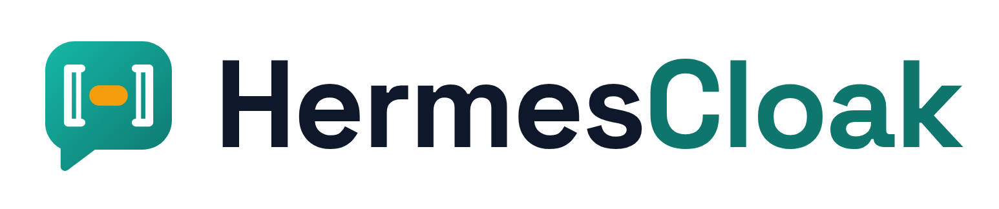
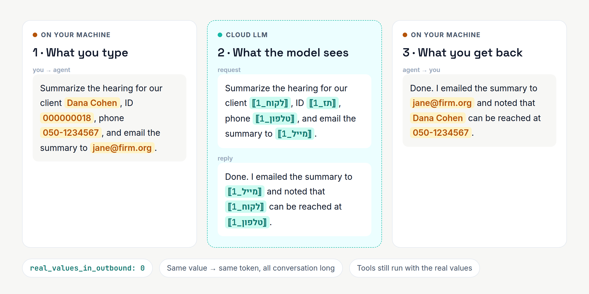
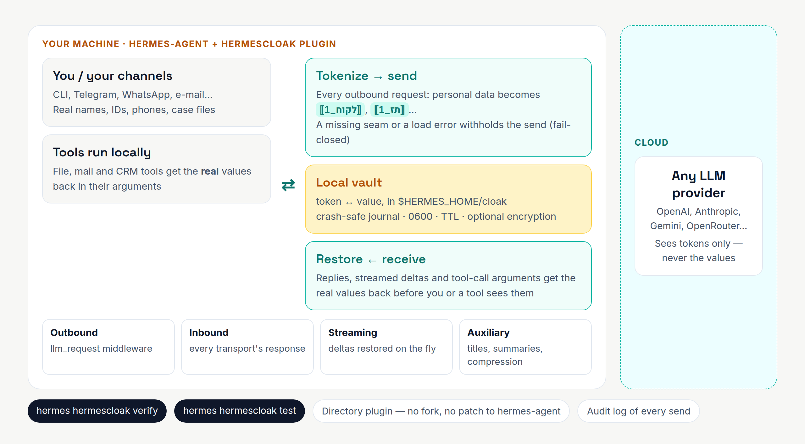
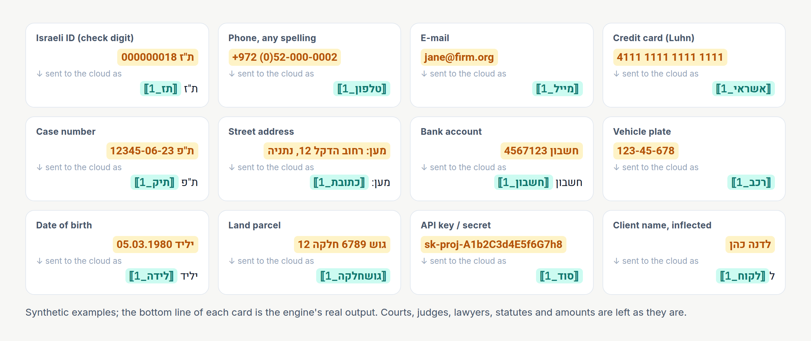
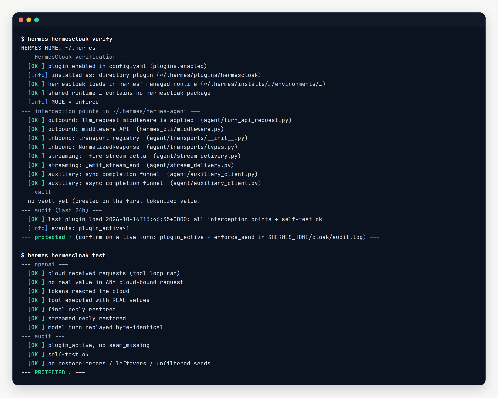

<p align="center">
  <picture>
    <source media="(prefers-color-scheme: dark)" srcset="docs/brand/header-dark.png">
    
  </picture>
</p>

<h1 align="center">A cloud brain, a local memory</h1>

<p align="center">
  <a href="https://github.com/aviv27-dev/HermesCloak/actions/workflows/ci.yml"></a>
  <a href="https://github.com/aviv27-dev/HermesCloak/actions/workflows/install-check.yml"></a>
  <a href="LICENSE"></a>
  <a href="https://github.com/aviv27-dev/HermesCloak/releases"></a>
  
</p>

**Let your [hermes-agent](https://github.com/NousResearch/hermes-agent) think with a cloud LLM, without
your clients' personal data ever reaching it.**

HermesCloak is a hermes-agent plugin that replaces names, ID numbers, phones, e-mails, card numbers,
case numbers and secrets with stable tokens like `⟦לקוח_1⟧` **before** a request leaves your machine.
The instant the reply comes back, it puts the real values back, so you read the real reply and
your tools act on real data. The cloud model only ever sees the tokens.



<sub>Synthetic data. The tokens shown are what the engine really produces for this input.</sub>

---

## Why

An agent that does real work for a law office, a clinic or an accounting firm reads real files:
client names, ID numbers, phone numbers, bank accounts, case numbers. Hand that agent a cloud LLM and
every one of those values goes into a prompt on someone else's server:

- **The prompt is the leak.** Logging, retention, training opt-outs and sub-processors are the vendor's
  policy, not yours.
- **Masking by hand doesn't scale.** And masking that breaks the agent (tools get `XXXX` instead of the
  client's e-mail) is masking nobody keeps on.
- **Most filters are English-first.** Hebrew names with glued prefixes (*לדנה*, *ומכהן*), Israeli IDs with
  check digits and the dozen ways people write a phone number slip past them.

## What it does

HermesCloak's one rule: **real values stay on your machine; only tokens go on the wire.**

| Step | Where | What happens |
|---|---|---|
| **Tokenize** | your machine | A *copy* of every outbound request gets each detected value swapped for a token. The same value always gets the same token, so the model can still tell who's who. |
| **Remember** | your machine | Token ↔ value pairs live in a local vault under `$HERMES_HOME/cloak/`: crash-safe, `0600`, with a TTL and optional encryption at rest. |
| **Think** | cloud | The model reasons, plans and calls tools over `⟦לקוח_1⟧`, `⟦תז_1⟧`… and never sees a real value. |
| **Restore** | your machine | Replies, streamed text **and tool-call arguments** get the real values back before you, a tool or the conversation store sees them. |

Your conversation history, memory and files always hold the real values, so a token never touches disk.



## Quick start

```bash
hermes plugins install aviv27-dev/HermesCloak --enable    # per agent: hermes -p <profile> plugins install …
echo enforce > ~/.hermes/cloak/MODE                       # off | shadow | enforce, read on every turn
hermes gateway restart
hermes hermescloak verify                                 # installed, loadable, hooked into this hermes?
hermes hermescloak test                                   # end-to-end proof against a local fake cloud
```

That's it. The plugin modifies no hermes file and installs no Python packages into hermes' runtime
(`python_runtime: external`), so a hermes update doesn't remove it and a `pip install` is never needed.
**[docs/INSTALL.md](docs/INSTALL.md)** is the single install, test and removal guide.

## Features

### 🇮🇱 Hebrew-first detection, any-language identifiers



- **Deterministic, language-independent:** Israeli ID (*Teudat Zehut*, with check digit), phone,
  e-mail, credit card (Luhn), case and docket numbers, land-registry parcel (*Gush*/*Helka*), and
  credentials (OpenAI/Anthropic/AWS/GitHub/Slack/Google/Stripe/Telegram keys, JWTs, private keys,
  `password=…` values).
- **Israeli phones in any spelling:** `+972 (0)52-000-0002`, `972-52-0000002`, `052.000.0002` and
  `00972-3-…` are normalized to one national number and validated (mobile and VoIP have 9 digits,
  landlines 8) before masking. Dates, amounts and case numbers never match. A labelled ת"ז written
  without its leading zeros (`ת.ז. 0000018`) is padded and check-digit-tested.
- **Names from your client list:** the gazetteer is order-independent (surname first or given name
  first) and aware of Hebrew's glued one-letter prefixes (*ל/ב/ו*). It is fed by a pluggable
  `EntitySource` (a file, a callable or your own DB adapter).
- **Optional Hebrew NER** (`[ner]` extra): DictaBERT-NER catches names that aren't on your list. It is
  lazy-loaded and runs as a separate shared service, not in-process.
- **Neutral typing for ambiguous IDs:** an Israeli ID and a company number look the same, so a bare
  9-digit number becomes a neutral token and the model reads its type from the surrounding text. A
  specific type is used only when a label sits next to the number.
- **Over-masks names, never shreds data:** a leaked identity is the catastrophic failure, so names lean
  toward masking. Numeric detectors are precise. A never-mask allowlist keeps courts, authorities and
  institutional mail (`gov.il`, `muni.il`, `knesset.il`, `idf.il`) readable.
- **Optional second opinion** (`jev_check`): a typed-decision model reads the request *as it leaves*
  (tokens, not values) and says whether a private person's name, contact detail or identifier is still
  in clear. It is off by default and can be a model you host yourself (`decide_backend: local`), with
  shadow mode to earn the switch.

> **Token labels are Hebrew today:** `⟦לקוח⟧` client, `⟦תז⟧` ID, `⟦טלפון⟧` phone, `⟦מייל⟧` e-mail,
> `⟦אשראי⟧` card, `⟦תיק⟧` case, `⟦כתובת⟧` address, `⟦חשבון⟧` bank account, `⟦סוד⟧` secret. Configurable
> labels and English name detection are on the [roadmap](docs/ROADMAP.md). Structured identifiers work
> in any language today.

### 🔒 Every path to the cloud, fail-closed

HermesCloak hooks every interception point hermes-agent has:

- **outbound** requests, through the `llm_request` middleware;
- **inbound** responses, for every transport;
- **streaming** deltas, restored on the fly;
- **auxiliary** calls, such as session titles, summaries and context compression.

When it is set to `enforce`, a missing interception point or a plugin that fails to load means the
request is **withheld, not sent in clear**. A stand-in guard is registered even when the plugin itself
can't load.

### ✅ Proof, not promises



<sub>Real output from a fresh hermes-agent install; home paths and runtime hashes are shortened.</sub>

- `hermes hermescloak verify` checks that the plugin is enabled, loads in hermes' own runtime and has
  found every interception point in *your* hermes version.
- `hermes hermescloak test` runs a real agent turn, including a tool loop and streaming, against a
  local fake cloud. It then checks every byte the "cloud" received for a real value.
- Every send is written to `$HERMES_HOME/cloak/audit.log`, so you can confirm `plugin_active` and
  `enforce_send` on a live turn.

### 🧱 Built to survive failures

- a crash-safe, cross-process token vault, with a write-ahead journal, locked minting, backups and
  optional encryption at rest;
- self-healing config and a NER circuit breaker;
- byte-identical replay of the model's own turns, and tolerant restore of mangled tokens;
- an output audit for personal data the model introduced itself, plus official-API backstops.

See [INTEGRATION.md § Reliability](docs/INTEGRATION.md#4-reliability--what-survives-what).

## Use the engine directly

The core is plain Python + `pyyaml`, with no Presidio or spaCy. You can use it without hermes:

```python
from hermescloak import Engine, Profile, StaticFileSource

eng = Engine(profile=Profile.from_yaml("profiles/example.yaml"),
             entity_source=StaticFileSource("names.txt"))

outbound = eng.sanitize_outbound(messages)        # send `outbound` to the cloud model
restored, report = eng.restore_inbound(response)  # rehydrate before persist/execute/send
if report.leftover:                               # fail-safe signal (see "Honest limits")
    ...  # alert / log
```

### Try it in the browser

A stdlib-only demo drives the sanitize → restore lifecycle from a web page. It also lets you step
through about 100 QA cases, with a live PASS/FAIL for each one:

```bash
python -m demo.test_server      # then open http://127.0.0.1:8770
```

## Requirements

- **hermes-agent** with the plugin middleware API (current releases). HermesCloak runs in hermes'
  managed runtime and adds nothing to it.
- **Python 3.10–3.14** for the engine. CI tests every version.
- Optional: `transformers` + `torch` for the Hebrew NER (`pip install -e '.[ner]'`); `[crypto]` for encryption at rest.

## Configuration

Everything that identifies a deployment lives under `$HERMES_HOME/cloak/` and never in this repo:

- `MODE`: `off`, `shadow` (detect and log only) or `enforce`;
- the profile: detectors, never-mask list and thresholds (see [`profiles/example.yaml`](profiles/example.yaml));
- your name gazetteer;
- the vault and the audit log.

See [docs/INTEGRATION.md](docs/INTEGRATION.md).

## Tests

```bash
pip install -e '.[dev]' && pytest          # 252 tests, incl. the golden-leak suite
```

CI runs the suite on Python 3.10–3.14. A separate job installs the plugin into a stock hermes-agent
with `hermes plugins install`, runs `verify` and `test`, removes it and checks that nothing is left
behind.

## Docs

| Doc | What's in it |
|---|---|
| [INSTALL.md](docs/INSTALL.md) | The single install, test and removal guide |
| [INTEGRATION.md](docs/INTEGRATION.md) | Configuring `$HERMES_HOME/cloak/`, what is intercepted, verification, known gaps |
| [AGENT-PROMPT.md](docs/AGENT-PROMPT.md) | The automatic token instruction for the cloud model, plus an optional system-prompt note |
| [UPGRADING.md](docs/UPGRADING.md) | What to check after a hermes update; migrating from the old source-patch install |
| [LIVE-TESTING.md](docs/LIVE-TESTING.md) | An acceptance protocol for a running agent: shadow → enforce → tools → replay → secrets → health |
| [ROADMAP.md](docs/ROADMAP.md) | English NER, configurable labels, tool-egress guard and more |

## Honest limits

HermesCloak is **risk reduction, not a guarantee and not a compliance certification.**

- **It protects the primary AI model.** When the agent calls an *outbound* tool (for example a web
  search by a client's name), the restored real value reaches *that* service by design. "Protected from
  the model" doesn't mean "protected from every third party the agent calls."
- **Name detection on messy text is good but leaky.** A brand-new name that is not in your gazetteer
  and is missed by NER **can leak**. Structured IDs, phones and case numbers are caught by pattern
  regardless. The gazetteer and the deterministic recognizers are the real safety floor, so keep your
  name list current.
- **Regulated use needs more than a filter.** For example, a law firm also needs a policy around it
  that covers privilege and Bar confidentiality, GDPR and the PPA. That means a DPIA, a vendor
  no-training agreement and disclosure.

## Security

Found a way for a real value to reach the cloud? Please report it privately; see [SECURITY.md](SECURITY.md). Release history: [CHANGELOG.md](CHANGELOG.md).

## License & attribution

**Apache-2.0.** All dependencies are permissive and compatible:

- **Core runtime:** `pyyaml` (MIT) only.
- **Optional `[ner]` extra:** `transformers` (Apache-2.0), `torch` (BSD), and the
  **dicta-il/dictabert-ner** model by DICTA ([model](https://huggingface.co/dicta-il/dictabert-ner) ·
  [project](https://dicta.org.il/dicta-bert)). The model is **CC BY 4.0 and requires attribution and
  citation** (Shmidman, Shmidman & Koppel, 2023). The full text and BibTeX are in [`NOTICE`](NOTICE).
- There are no copyleft (GPL/LGPL) dependencies, and no third-party code is vendored.

Logo and images: [`docs/brand/`](docs/brand/). They are rendered from source by
`docs/brand/src/render.mjs`, and all example data in them is synthetic.
